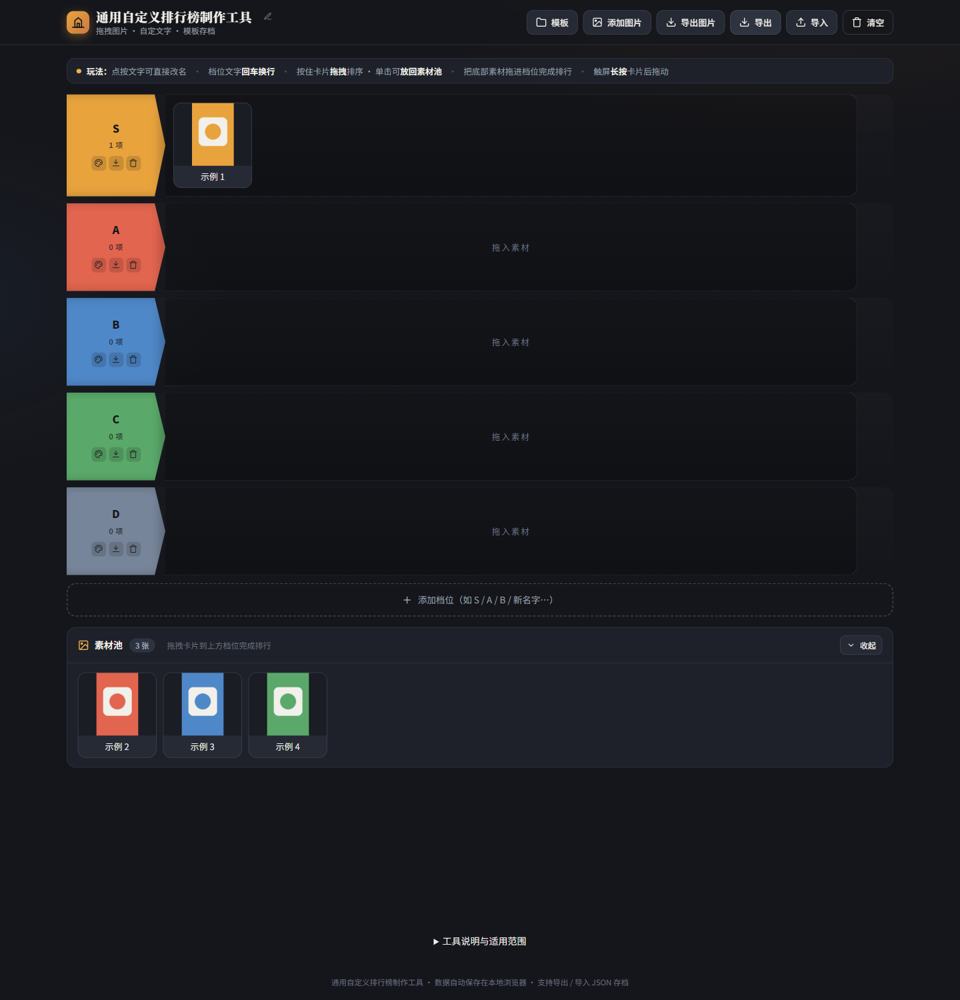

# 通用自定义排行榜制作工具

一个直接在浏览器中使用的图文分级排行榜工具。把图片加入素材池，拖进自定义档位，再导出 PNG 图片或 JSON 存档。无需安装、登录或配置后端。

## 下载即用

**[下载完整便携版 ZIP](https://github.com/YushiroYukina/custom-tier-list-maker/releases/latest/download/custom-tier-list-maker-v0.1.0.zip)** · [查看发布页](https://github.com/YushiroYukina/custom-tier-list-maker/releases/latest)

| 你想怎么用 | 下载入口 | 打开方式 |
| --- | --- | --- |
| 推荐：工具、模板和说明一起下载 | [完整便携版 ZIP](https://github.com/YushiroYukina/custom-tier-list-maker/releases/latest/download/custom-tier-list-maker-v0.1.0.zip) | 完整解压，双击 `index.html` |
| 只要一个能用的网页文件 | [单文件 HTML](https://github.com/YushiroYukina/custom-tier-list-maker/releases/latest/download/custom-tier-list-maker.html) | 下载后用浏览器打开 |
| 核对下载文件 | [SHA256 校验值](https://github.com/YushiroYukina/custom-tier-list-maker/releases/latest/download/SHA256SUMS.txt) | 比较文件的 SHA256 |

无需安装，也不需要 Python、Node.js 或账号。建议在电脑上使用现代版 Edge、Chrome 等浏览器；已在 Windows 的 Tabbit 浏览器中验证基本操作。Mac、Linux 可尝试浏览器打开，尚未逐平台验收。手机和平板的触控体验尚未做真机验收。

**三步开始：下载并打开 → 添加自己的图片 → 拖进档位并导出。** 可为动画、书籍、游戏、影视、美食等内容自定义分级。

## 快速开始

1. 点击上方“完整便携版 ZIP”，完整解压后双击 `index.html`，或直接下载并打开单文件 HTML。
2. 点击标题或档位文字修改名称，使用档位旁的按钮调整颜色、清空或删除档位，底部可新增档位。
3. 点击“添加图片”，选择一张或多张本地图片。图片会自动压缩后加入素材池，卡片文字可直接编辑。
4. 将卡片从素材池拖入档位，在档位内或档位间拖拽排序。
5. 点击“导出图片”保存 PNG。点击“导出”保存可继续编辑的 JSON 存档。

只想先收集素材时，可以把卡片全部留在素材池，之后再分类。

## 主要功能

| 功能 | 说明 |
| --- | --- |
| 自定义标题与档位 | 直接编辑文字，档位支持手动换行、新增、删除和配色 |
| 图文卡片与素材池 | 本地图片批量添加、图片链接添加、文字修改、删除、回到素材池 |
| 拖拽整理 | 档位内排序、档位间移动、从素材池加入档位；提供触屏长按拖拽交互 |
| 结构模板 | 保存和复用档位文字、颜色与标题，保存在当前浏览器中 |
| JSON 存档 | 保存完整当前状态，包括图片引用、文字、档位、素材池和顺序；可重新导入继续编辑 |
| PNG 导出 | 每行最多 12 张卡片，超出自动换行；相邻封面无间隙，标题区用细线分隔 |
| 浏览器自动保存 | 优先使用 IndexedDB，不可用时回退 localStorage |
| 单文件运行 | HTML、CSS、JavaScript 和通用演示图均在 `index.html` 中，无构建步骤和第三方运行库 |

## 适用范围

适合动画、书籍、游戏、影视、音乐、美食等个人主观分级，也可用于选项比较、收藏整理、团队讨论时制作一张静态展示图。档位文字不限于分数，可以使用 S/A/B、喜欢程度、推荐程度或任何自定义标签。

这是手动整理工具。它不读取 Excel、不连接 Bangumi 等数据库、不自动获取封面、不根据分数自动分档，也没有账号、云端同步、多人实时协作或客观评分计算功能。此前动画榜单的数据提取和封面获取属于工具之外的处理流程。

## 导出与数据边界

- PNG 只导出上方分级区，素材池不进入图片。每档即使为空也会保留展示区域。
- 封面格为 132 × 198 像素（2:3），通过居中裁切铺满。卡片名称在 PNG 中最多两行，过长内容会截断，JSON 保留完整文字。
- 本地图片最长边压缩至不超过 480 像素。动画图片可能转成静态画面，导出 PNG 也是静态图。
- 批量上传后，默认文字取文件名并截短至 14 个字符；可点击卡片文字改成完整标题。读取异步进行，加入素材池的顺序不保证与文件选择顺序一致。
- JSON 中本地上传图通常内嵌为 data URL；外部图片仍是链接。使用演示卡片时，存档可能保留 `demo:N` 引用，需要配套本工具恢复。
- 自动保存属于当前浏览器和访问位置的数据，清理浏览器数据、切换浏览器、移动本地 HTML 或更换站点地址后，存档可能不再可见。请用 JSON 主动备份。
- 应用没有服务端上传和统计代码。使用本地图片时无需联网；添加外站图片链接会向对应网站请求图片，可能遇到防盗链、跨域限制或失效。PNG 导出遇到不可读图片会使用名称占位。
- 大量图片会增加内存和存档体积，特别长的排行榜可能超过浏览器画布或存储限制。

## 示例与说明

- [详细使用说明](docs/USER_GUIDE.md)
- [通用空白模板](examples/通用空白模板.json)
- [素材池示例](examples/素材池示例.json)
- [GitHub 发布准备说明](docs/PUBLISHING.md)
- [版本记录](CHANGELOG.md)

## 技术结构

纯 HTML、CSS、原生 JavaScript；浏览器 IndexedDB/localStorage 持久化，Canvas 生成 PNG，FileReader 读取本地图片。直接部署静态文件即可。

代码仓库：[YushiroYukina/custom-tier-list-maker](https://github.com/YushiroYukina/custom-tier-list-maker)。在线页面托管尚未启用。

为兼容既有 JSON，保留 `app: "hanla-ranking"`、`version: 1` 和原有数据字段。工具显示名称已统一更新。

## 许可与素材

本项目尚未指定开源许可证。公开仓库不等于授予他人使用、修改或再分发的许可，正式发布前请由维护者选择许可证并确认原始代码的发布授权。当前包的色块演示图由简单几何图形生成，不包含个人榜单、动画封面或 Excel 数据。用户自行导入图片的权利归相应权利人所有。
